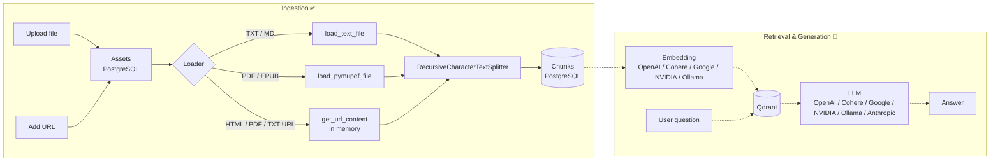

<div align="center">

# **RagForge** 🔍

**A modular Retrieval-Augmented Generation (RAG) backend built with FastAPI.**


</div>

---

## 📑 Table of Contents

- [Overview](#overview)
- [Project Status](#project-status)
- [Architecture](#architecture)
- [Tech Stack](#tech-stack)
- [Project Structure](#project-structure)
- [Getting Started](#getting-started)
- [Configuration](#configuration)
- [API Reference](#api-reference)
- [Supported Sources](#supported-sources)
- [Security](#security)
- [Roadmap](#roadmap)
- [License](#license)

---

## 🔎 Overview

**RagForge** is a backend service that prepares your data for Retrieval-Augmented Generation (RAG).

It is organized around **projects**: each project owns a set of **assets** (uploaded files or web URLs) that are processed into **chunks** and stored in **PostgreSQL**, ready to be embedded into a vector database (Qdrant) and used to answer questions grounded in your own data.

### Key Concepts

| Concept | Description |
|---------|-------------|
| `project_id` | A **positive integer** auto-increment primary key (PostgreSQL `projects` table). |
| `project_uuid` | A unique UUID generated when the project is created (PostgreSQL `projects` table). |
| `asset` | A file or URL uploaded to a project. Stored in `assets` table. |
| `chunk` | A text segment extracted from an asset, stored in `chunks` table. |
| `provider` | Pluggable LLM or vector DB backend (factory pattern). |

---

## 📊 Project Status

> **This project is under active development.** The ingestion pipeline is functional; retrieval and answer generation are next.

| # | Stage | Component | Status |
|:---:|-------|-----------|:------:|
| 1 | File upload & validation | ✅ Done | `POST /api/v1/data/upload/{project_id}` |
| 2 | URL ingestion (in-memory, no download to disk) | ✅ Done | `POST /api/v1/data/upload-url/{project_id}` |
| 3 | Text extraction & chunking | ✅ Done | `src/rag_app/controllers/ProcessController.py` |
| 4 | Chunk storage in PostgreSQL | ✅ Done | `src/rag_app/models/ChunkModel.py` |
| 5 | LLM providers (OpenAI, Cohere, Google, NVIDIA, Ollama, Anthropic) | ✅ Implemented — **wiring to endpoints in progress** | `src/rag_app/stores/llm/providers/` |
| 6 | Vector DB provider (Qdrant) | ✅ Implemented — **wiring to endpoints in progress** | `src/rag_app/stores/vectorDB/providers/QdrantDBProvider.py` |
| 7 | Indexing chunks into the vector DB | ✅ **Functional** | `POST /api/v1/nlp/index/push/{project_id}` |
| 8 | Semantic search endpoint | 🚧 Planned | `/nlp/index/search/{project_id}` |
| 9 | RAG answer generation endpoint | 🚧 Planned | `/nlp/index/answer/{project_id}` |

---

## 🏗️ Architecture



### Component Interaction Flow

1. **Upload/URL Ingestion** → `DataController` → Save file/URL content to disk → Create `Asset` record in PostgreSQL.
2. **Chunking** → `ProcessController` → Extract text → Split into chunks (using LangChain `RecursiveCharacterTextSplitter`).
3. **Storage** → `ChunkModel` → Insert chunks into PostgreSQL (`chunks` table).
4. **Indexing** → `NlpController.index_into_vector_db()` → Generate embeddings (via `EmbeddingClient`) → Push vectors to Qdrant.
5. **Search/Answer** → `NlpController` → Retrieve relevant chunks from Qdrant → Build prompt → Generate answer using `GenerationClient`.

---

## 🧰 Tech Stack

| Layer | Technology |
|-------|------------|
| **Runtime** | Python 3.14 |
| **Web Framework** | FastAPI |
| **ORM / Async DB Driver** | SQLAlchemy 2.x (async) with `psycopg[binary]` (PostgreSQL async driver) |
| **Vector DB** | Qdrant |
| **LLM Providers** | OpenAI, Cohere, Google Gemini, NVIDIA NIM, Ollama (local), Anthropic (generation only) |
| **Embedding** | (same providers via `embed_text`) |
| **Text Processing** | `RecursiveCharacterTextSplitter` (LangChain) |
| **PDF/EPUB Parsing** | PyMuPDF |
| **URL Parsing** | `trafilatura` (HTML), `pymupdf` (PDF) |
| **Package Manager** | `uv` |
| **Templating** | Python `string.Template` (locale files `en`, `ar`) |
| **Database Migrations** | Alembic |

---

## 📁 Project Structure

```
Mini_Rag/
├── .env.example
├── .gitignore
├── README.md
├── alembic.ini
├── alembic/
│   ├── env.py
│   ├── script.py.mako
│   └── versions/
├── Docker/
│   ├── docker.compose.yaml    # Docker compose (pgvector service)
│   └── .env.example
├── pyproject.toml
├── uv.lock
└── src/
    └── rag_app/
        ├── __init__.py
        ├── main.py                  # FastAPI app, lifespan, DB init, client creation
        ├── helper/
        │   ├── __init__.py
        │   └── config.py              # Settings (Pydantic Settings)
        ├── controllers/
        │   ├── BaseController.py
        │   ├── DataController.py      # File validation, path generation
        │   ├── ProcessController.py   # URL/file loading, chunking
        │   ├── ProjectController.py   # Project path management
        │   └── NlpController.py       # Vector DB + RAG answer logic
        ├── routes/
        │   ├── base.py                # /api/v1/ (health check)
        │   ├── data.py                # /api/v1/data/ (upload, url, process)
        │   ├── nlp.py                 # /api/v1/nlp/ (index, search, answer)
        │   └── schemes/
        │       ├── data.py            # ProcessRequest, URLRequest
        │       └── nlp.py             # PushRequest, SearchRequest
        ├── models/
        │   ├── BaseDataModel.py
        │   ├── ProjectModel.py          # projects CRUD
        │   ├── AssetModel.py            # assets CRUD
        │   ├── ChunkModel.py            # chunks CRUD
        │   └── db_schemes/
        │       ├── RagApp/schemes/
        │       │   ├── project.py       # projects table (PK: project_id INT)
        │       │   ├── asset.py         # assets table (FK: asset_project_id)
        │       │   ├── data_chunk.py    # chunks table (FK: chunk_project_id, chunk_asset_id)
        │       │   └── __init__.py
        │       └── __init__.py
        ├── stores/
        │   ├── llm/
        │   │   ├── LLMinterface.py      # Abstract LLM base class
        │   │   ├── LLMProviderFactory.py
        │   │   ├── LLMEnums.py
        │   │   ├── LLMErrors.py
        │   │   ├── providers/
        │   │   │   ├── OpenAiProvider.py
        │   │   │   ├── CohereProvider.py
        │   │   │   ├── OllamaProvider.py
        │   │   │   ├── NvidiaProvider.py
        │   │   │   ├── AnthropicProvider.py
        │   │   │   └── GoogleProvider.py
        │   │   └── templates/
        │   │       ├── template_parser.py
        │   │       └── locales/ (en, ar)
        │   └── vectorDB/
        │       ├── VectorDBInterFace.py
        │       ├── VectorDBProviderFactory.py
        │       └── providers/
        │           └── QdrantDBProvider.py
        └── assets/
            ├── files/                   # Uploaded files stored here
            ├── db/                      # Qdrant local storage
            └── mini-rag-app.postman_collection.json
```

---

## 🚀 Getting Started

### Prerequisites

- **Python 3.14** (see `.python-version`)
- **PostgreSQL 16+** with `pgvector` extension
- `uv` package manager
- Qdrant (embedded if `VECTOR_DB_URL` not set)

### Option A: Local Setup

#### 1. Clone the repository

```bash
git clone https://github.com/Amir-Hossni/RagForge.git
cd Mini_Rag
```

#### 2. Create and activate a virtual environment

```bash
uv venv .venv
source .venv/bin/activate
```

#### 3. Install dependencies

```bash
uv pip install -r requirements.txt
```

#### 4. Configure environment variables

```bash
cp .env.example .env
# Edit .env with your credentials
```

#### 5. Create and run database migrations

```bash
alembic upgrade head
```

#### 6. Run the application

```bash
uv run fastapi dev src/rag_app/main.py
# or
uv run uvicorn rag_app.main:app --reload --host 0.0.0.0 --port 5000
```

The API will be available at `http://localhost:5000`.

---

### Option B: Docker Compose

#### 1. Configure environment variables

```bash
cd Docker
cp .env.example .env
# Edit .env with your credentials
```

#### 2. Start the services

```bash
docker compose -f docker.compose.yaml up -d pgvector
```

> **Note:** `docker compose -f docker.compose.yaml up -d pgvector` starts only the PostgreSQL service, while `docker compose -f docker.compose.yaml up -d` starts all services.

---

## ⚙️ Configuration

| Variable | Required | Example | Description |
|----------|----------|---------|-------------|
| `APP_NAME` | ✅ | `RagForge` | App name |
| `APP_VERSION` | ✅ | `0.1` | App version |
| `POSTGRES_USERNAME` | ✅ | `postgres` | DB user |
| `POSTGRES_PASSWORD` | ✅ | `secret` | DB password |
| `POSTGRES_HOST` | ✅ | `localhost` | DB host |
| `POSTGRES_PORT` | ✅ | `5432` | DB port |
| `POSTGRES_MAIN_DATABASE` | ✅ | `ragforge` | DB name |
| `GENERATION_BACKEND` | ✅ | `openai` | `openai`, `cohere`, `google`, `nvidia`, `ollama`, `anthropic` |
| `EMBEDDING_BACKEND` | ✅ | `openai` | Same as above |
| `GENERATION_MODEL_ID` | ✅ | `gpt-4o-mini` | Model name for generation |
| `EMBEDDING_MODEL_ID` | ✅ | `text-embedding-3-small` | Model name for embeddings |
| `EMBEDDING_MODEL_SIZE` | ✅ | `1536` | Embedding vector size |
| `OLLAMA_API_URL` | ⚠️ | `http://localhost:11434` | Ollama server URL |
| `VECTOR_DB_BACKEND` | ✅ | `qdrant` | `qdrant` |
| `VECTOR_DB_PATH` | ✅ | `qdrant_db` | Local storage path |
| `FILE_ALLOWED_TYPES` | ✅ | `["text/plain", "application/pdf"]` | Allowed MIME types |
| `FILE_MAX_SIZE` | ✅ | `100` | Max file size in MB |
| `FILE_DEFAULT_CHUNK_SIZE` | ✅ | `512000` | Chunk size in characters |
| `URL_REQUEST_TIMEOUT` | ✅ | `15` | URL fetch timeout (seconds) |
| `URL_MAX_REDIRECTS` | ✅ | `5` | URL fetch max redirects |
| `PRIMARY_LANGUAGE` | ✅ | `en` | Template language (`en`, `ar`) |
| `DEFAULT_LANGUAGE` | ✅ | `en` | Fallback language |

---

## 🔌 API Reference

> Base URL: `http://localhost:8000/api/v1`

### 🔷 Data Endpoints

#### `POST /api/v1/data/upload/{project_id}`

Upload a file (local) to a project.

| Parameter | Type | Description |
|-----------|------|-------------|
| `project_id` | int | Positive integer, auto-increment PK in `projects` table |
| `file` | UploadFile | File to upload |

**Response:**
```json
{
  "signal": "FILE_UPLOAD_SUCCESS",
  "file_id": "1"
}
```

#### `POST /api/v1/data/upload-url/{project_id}`

Register a public URL as an asset in a project.

| Parameter | Type | Description |
|-----------|------|-------------|
| `project_id` | int | Positive integer |
| `url_request` | URLRequest | `{ "url": "https://example.com" }` |

**Response:**
```json
{
  "signal": "URL_ADDED_SUCCESS",
  "file_id": "1"
}
```

#### `POST /api/v1/data/process/{project_id}`

Process all assets in a project: extract text, chunk, and store.

| Parameter | Type | Description |
|-----------|------|-------------|
| `project_id` | int | Positive integer |
| `process_request` | ProcessRequest | `{ "chunk_size": 100, "overlap_size": 20, "do_reset": 0 }` |

**Response:**
```json
{
  "signal": "PROCESSING_SUCCESS",
  "inserted_chunks": 42,
  "processed_files": 2
}
```

### 🔷 NLP Endpoints

#### `POST /api/v1/nlp/index/push/{project_id}` ⏳ Planned

Index chunks into the vector database.

#### `POST /api/v1/nlp/index/search/{project_id}` ⏳ Planned

Semantic search.

#### `POST /api/v1/nlp/index/answer/{project_id}` ⏳ Planned

RAG answer generation.

### 🔷 Error Signals

| Signal | Meaning |
|--------|---------|
| `FILE_TYPE_NOT_SUPPORTED` | MIME type not allowed |
| `FILE_EMPTY` | File is empty |
| `FILE_SIZE_EXCEEDED` | File exceeds `FILE_MAX_SIZE` |
| `FILE_UPLOADED_SUCCESS` | File successfully uploaded |
| `FILE_UPLOAD_FAILED` | Error while writing file |
| `URL_ADDED_SUCCESS` | URL registered as asset |
| `URL_ALREADY_EXISTS` | URL already registered in project |
| `URL_NOT_ALLOWED` | URL rejected (non-public or unresolvable host) |
| `PROCESSING_SUCCESS` | Chunks created and stored |
| `PROCESSING_FAILED` | No asset could be processed |
| `PROJECT_ID_INVALID` | `project_id` is not a positive integer |
| `NO_FILES_ERROR` | Project has no assets |
| `NOT_FOUND_FILES` | Asset not found |

A Postman collection is available at:  
`src/rag_app/assets/mini-rag-app.postman_collection.json`

---

## 📚 Supported Sources

| Source | Formats | `ProcessController` method | Notes |
|--------|---------|----------------------------|-------|
| Local file | `.txt`, `.md` | `load_text_file` | UTF-8. Extensions are case-insensitive (`.PDF` = `.pdf`) |
| Local file | `.pdf`, `.epub` | `load_pymupdf_file` (PyMuPDF) | One document per page with metadata |
| URL | HTML pages | `load_html_content` (trafilatura) | Main content only (menus, footers, ads removed); title, author, date, site name kept |
| URL | PDF | `load_pdf_content` (PyMuPDF) | Parsed from memory |
| URL | Plain text / Markdown | `load_text_content` | Decoded using response charset |

> **Note:** Some clients upload `.md` files as `application/octet-stream`. Add that MIME type to `FILE_ALLOWED_TYPES` if needed.
> Pages rendered entirely by JavaScript (SPAs) are not supported yet.

---

## 🔒 Security

User-supplied URLs are a common **SSRF** (Server-Side Request Forgery) vector. `ProcessController.validate_public_url` and `fetch_url` apply these protections:

- Only `http` and `https` schemes are accepted.
- The hostname is resolved, and **every** resolved IP must be public. Loopback, private, link-local (including cloud metadata `169.254.169.254`), and reserved ranges are rejected. Tricks like decimal IPs (`http://2130706433`) are also rejected.
- Redirects are followed manually, and **each hop is re-validated**.
- Response size is limited by `FILE_MAX_SIZE` while streaming. Requests are bounded by a timeout.
- **Known limitation:** The connection is not pinned to the validated IP, so a DNS-rebinding attack remains theoretically possible. Pinning the IP in the HTTP transport is planned.

---

## 🗺️ Roadmap

- [x] **Already Implemented:** All 6 LLM providers (`OpenAI`, `Cohere`, `Google`, `NVIDIA`, `Ollama`, `Anthropic`)
- [x] **Already Implemented:** Qdrant vector DB provider
- [x] **Already Implemented:** `/api/v1/data/upload/{project_id}` endpoint
- [x] **Already Implemented:** `/api/v1/data/upload-url/{project_id}` endpoint
- [x] **Already Implemented:** `/api/v1/data/process/{project_id}` endpoint
- [x] **Already Implemented:** `/api/v1/nlp/index/push/{project_id}` endpoint
- [ ] Semantic search endpoint (`/nlp/index/search/{project_id}`)
- [ ] RAG answer generation endpoint (`/nlp/index/answer/{project_id}`)
- [ ] More loaders: DOCX, CSV / JSON, YouTube transcripts, OCR for scanned PDFs
- [ ] Encoding auto-detection for non-UTF-8 text files
- [ ] Pin URL connections to the validated IP (DNS-rebinding protection)
- [ ] Create PostgreSQL indexes once at startup (indexes are currently created only when a collection is first created)
- [ ] Automated tests and CI
- [ ] Dockerfile for the API service

---

## 📜 License

License to be defined.

> This project depends on **PyMuPDF**, which is licensed under **AGPL-3.0** (a commercial license is available from Artifex). Take this into account when choosing a license or deploying the service.

---

<div align="center">

Made by **Amir Hossni**

[](https://github.com/Amir-Hossni)
[](https://python.org)
[](https://fastapi.tiangolo.com)

</div>
